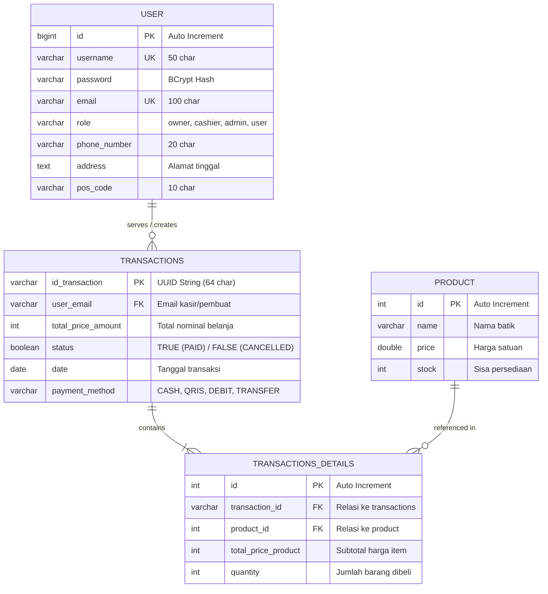
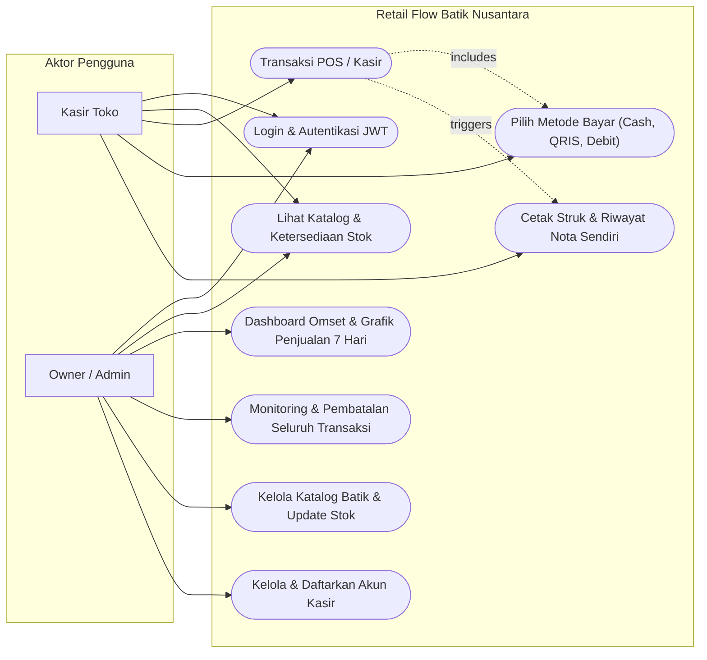
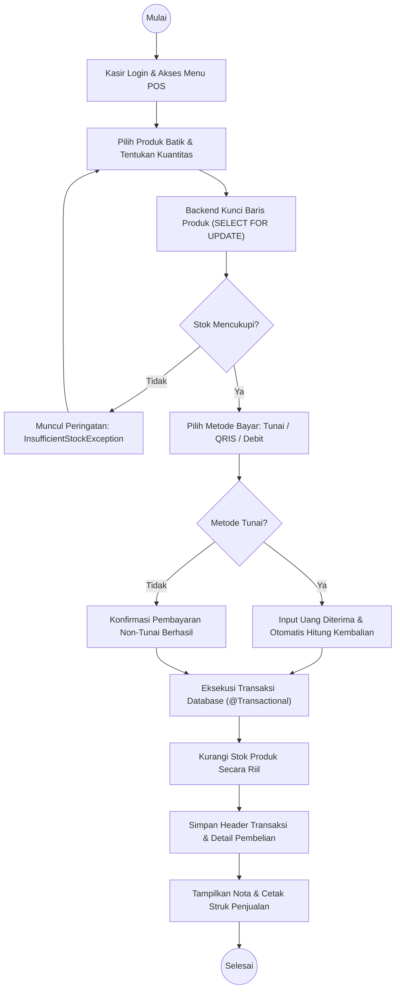
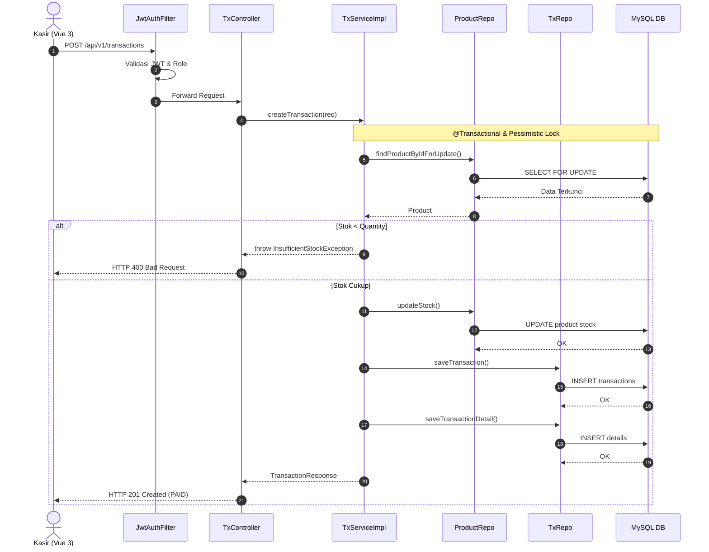

# 🛍️ Retail Flow — Sistem Manajemen POS & Toko Batik

> **Retail Flow Batik Nusantara** adalah solusi monorepo aplikasi Point of Sale (POS) dan manajemen toko ritel batik modern yang menggabungkan keandalan backend enterprise **Java Spring Boot 3** dengan antarmuka frontend reaktif dan estetik berbasis **Vue 3 + Tailwind CSS**.

---

## 🏗️ Arsitektur Monorepo

```text
retail_project/
├── docker-compose.yml          # Konfigurasi containerized stack (Backend + MySQL)
├── README.md                   # Dokumentasi utama proyek
├── apps/
│   ├── backend/                # REST API Backend (Spring Boot 3 + MySQL 8 + Flyway)
│   │   ├── Dockerfile          # Multi-stage build container (Maven + Eclipse Temurin JDK 21)
│   │   ├── docker-compose.yml  # Docker compose lokal backend
│   │   └── src/                # Controller, Service, Repository, Security, Seed SQL
│   └── frontend/               # Single Page Application (Vue 3 + Vite + Tailwind CSS)
│       ├── package.json
│       ├── vite.config.ts      # Reverse proxy ke API backend
│       └── src/                # Dashboard Owner, POS Kasir, Katalog Produk, Riwayat
```

---

## 📊 Diagram & Pemodelan Sistem (UML & Database)

Dokumentasi diagram sistem mencakup pemodelan data relasional, arsitektur kelas berorientasi objek, hak akses pengguna, alur logika proses transaksi, dan urutan interaksi komponen backend-frontend.

### 1. Entity-Relationship Diagram (ERD)

Diagram relasi entitas basis data MySQL (`java_toko_online`) yang memodelkan relasi antara pengguna/kasir, produk batik, transaksi induk, dan rincian transaksi:



---

### 2. Class Diagram (Arsitektur Backend & Domain)

Diagram kelas menunjukkan penerapan *Layered Architecture* (Controller -> Service -> Repository/Entity) berbasis Spring Boot 3 dengan prinsip *Dependency Inversion* & *Single Responsibility*:

```mermaid
classDiagram
    direction TB

    class AuthController {
        +login(LoginRequest) ResponseEntity~ApiResponse~
        +register(RegisterRequest) ResponseEntity~ApiResponse~
    }

    class ProductController {
        +getAllProducts() ResponseEntity~ApiResponse~
        +getProductById(int) ResponseEntity~ApiResponse~
        +createProduct(ProductRequest) ResponseEntity~ApiResponse~
        +updateProduct(int, UpdateProductRequest) ResponseEntity~ApiResponse~
        +deleteProduct(int) ResponseEntity~ApiResponse~
    }

    class TransactionController {
        +buyProduct(TransactionRequest) ResponseEntity~ApiResponse~
        +getTransactions(String) ResponseEntity~ApiResponse~
        +getTransactionById(String) ResponseEntity~ApiResponse~
        +cancelTransaction(String) ResponseEntity~ApiResponse~
    }

    class UserController {
        +getProfile() ResponseEntity~ApiResponse~
        +getAllCashiers() ResponseEntity~ApiResponse~
    }

    class AuthService {
        <<interface>>
        +login(LoginRequest) LoginResponse
        +register(RegisterRequest) UserResponse
    }

    class ProductService {
        <<interface>>
        +findAll() List~ProductResponse~
        +findById(int) ProductResponse
        +create(ProductRequest) ProductResponse
        +update(int, UpdateProductRequest) ProductResponse
        +delete(int) void
    }

    class TransactionService {
        <<interface>>
        +createTransaction(TransactionRequest) TransactionResponse
        +getTransactions(String) List~TransactionResponse~
        +getTransactionById(String) TransactionDetailResponse
        +cancelTransaction(String) void
    }

    class User {
        -Long id
        -String username
        -String password
        -String email
        -Role role
        -String phoneNumber
        -String address
        -String posCode
        +getId() Long
        +getUsername() String
        +getEmail() String
        +getRole() Role
    }

    class Product {
        -Integer id
        -String name
        -Double price
        -Integer stock
        +getId() Integer
        +getName() String
        +getPrice() Double
        +getStock() Integer
    }

    class Transaction {
        -String idTransaction
        -String userEmail
        -Integer totalPriceAmount
        -TransactionStatus status
        -Date date
        -PaymentMethod paymentMethod
        -List~TransactionDetail~ details
        +getIdTransaction() String
        +getTotalPriceAmount() Integer
        +getStatus() TransactionStatus
    }

    class TransactionDetail {
        -Integer id
        -String transactionId
        -Integer productId
        -Integer totalPriceProduct
        -Integer quantity
        -Product product
        +getId() Integer
        +getQuantity() Integer
        +getTotalPriceProduct() Integer
    }

    class Role {
        <<enumeration>>
        OWNER
        CASHIER
        ADMIN
        USER
    }

    class PaymentMethod {
        <<enumeration>>
        CASH
        QRIS
        DEBIT
        TRANSFER
    }

    class TransactionStatus {
        <<enumeration>>
        PAID
        CANCELLED
        PENDING
    }

    AuthController ..> AuthService : depends on
    ProductController ..> ProductService : depends on
    TransactionController ..> TransactionService : depends on

    User "1" *-- "1" Role : has
    Transaction "1" *-- "1" PaymentMethod : uses
    Transaction "1" *-- "1" TransactionStatus : state
    Transaction "1" *-- "*" TransactionDetail : contains
    TransactionDetail "*" o-- "1" Product : references
```



---

### 3. Use Case Diagram (Hak Akses & Peran Pengguna)

Pemetaan kasus penggunaan untuk peran **Kasir** dan **Owner / Admin** pada sistem Retail Flow:



---

### 4. Activity Diagram (Alur Transaksi POS Kasir)

Diagram aktivitas menggambarkan alur lengkap saat kasir memproses pesanan pembeli hingga nota tercetak dan stok diperbarui secara atomik:



---

### 5. Sequence Diagram (Proses Checkout & Pengurangan Stok)

Diagram sekuens menampilkan interaksi antar-komponen dari Frontend (Vue 3 / Axios), Filter Keamanan Spring Security, Controller, Service Layer, hingga Database MySQL dengan *Pessimistic Locking*:



---

## 🚀 Panduan Menjalankan Aplikasi

Aplikasi dirancang agar dapat dijalankan dengan cepat hanya dalam 2 langkah:

### 1. Jalankan Backend & Database (Docker) — Terminal 1

Buka terminal pada direktori root proyek (`d:\project\retail_project`):

```bash
docker compose up -d
```

> **Informasi Servis Backend:**
> - **REST API URL:** `http://localhost:8080`
> - **Swagger UI (Dokumentasi Interaktif):** `http://localhost:8080/swagger-ui.html`
> - **OpenAPI 3 JSON Spec:** `http://localhost:8080/api/docs`
> - **Healthcheck Actuator:** `http://localhost:8080/actuator/health`
> - **Database MySQL:** Port `3306` (`jdbc:mysql://localhost:3306/java_toko_online`)
> - Untuk menghentikan container: `docker compose down`

---

### 2. Jalankan Frontend (Vite Dev Server) — Terminal 2

Buka terminal baru di root project lalu jalankan aplikasi frontend:

```bash
cd apps/frontend
npm run dev
```

> **Informasi Frontend:**
> - **Akses Web UI:** `http://localhost:5173`
> - Dev server Vite otomatis melakukan reverse proxy seluruh request `/api/*` ke backend `http://localhost:8080`.

---

## 🔑 Kredensial Akun Bawaan (Database Seed)

Aplikasi telah dilengkapi dengan data akun awal yang siap langsung digunakan untuk login:

| Role | Username | Email | Password | Hak Akses Utama |
|---|---|---|---|---|
| **Owner / Admin** | `budi.owner` | `budi.owner@retailflow.id` | `password123` | Dashboard metrik omset & chart, CRUD Kasir, CRUD Produk, pantau seluruh transaksi |
| **Kasir** | `rani.kasir` | `rani.kasir@retailflow.id` | `password123` | Modul Kasir (POS penjualan), pencatatan nota, pantau transaksi akun sendiri |
| **Administrator** | `admin` | `admin@toko.com` | `password123` | Akses penuh manajemen sistem & API |

---

## 👗 Katalog Produk Bawaan (Batik Nusantara)

Database telah ter-seed dengan produk batik Nusantara otentik:

1. **Kemeja Parang Sagara** — Rp 385.000 (Stok: 35)
2. **Outer Kawung Senja** — Rp 465.000 (Stok: 24)
3. **Blus Sekar Jagad** — Rp 329.000 (Stok: 40)
4. **Kain Lereng Pesisir** — Rp 550.000 (Stok: 15)
5. **Kemeja Batik Mega Mendung** — Rp 420.000 (Stok: 28)
6. **Tunik Batik Truntum Klasik** — Rp 365.000 (Stok: 18)
7. **Kain Batik Tulis Sidomukti** — Rp 650.000 (Stok: 8 - *Peringatan Stok Menipis*)
8. **Selendang Batik Cuwiri Sutra** — Rp 275.000 (Stok: 22)

---

## 🌟 Fitur Utama Sistem

### 1. Dashboard Owner (`/dashboard`)
- **Total Pemasukan & Omset Harian:** Akumulasi riil dari transaksi sukses (`PAID`).
- **Average Order Value (Avg):** Rata-rata nominal belanja per transaksi.
- **Aktivitas Penjualan (Chart 7 Hari):** Grafik batang dinamis omset 7 hari terakhir dengan visual bar responsif dan tooltip nominal Rupiah.
- **Produk Terlaris & Peringatan Stok Menipis:** Indikator otomatis untuk produk dengan stok $\le 10$ unit.

### 2. POS Kasir (`/cashier`)
- Keranjang belanja interaktif dengan pemilihan produk batik dan variasi ukuran.
- Berbagai metode pembayaran: Tunai (otomatis hitung kembalian), QRIS, Debit, Transfer.
- Integrasi otomatis dengan pengurangan stok produk di backend dan pencatatan transaksi kasir.

### 3. Manajemen Kasir & Staf (`/admin/cashiers`)
- Khusus diakses oleh Owner untuk memonitor kasir toko.
- Tambah kasir baru langsung tersinkronisasi dan terdaftar di database MySQL backend (`POST /api/v1/auth/register`).

### 4. Manajemen Produk & Stok (`/admin/products`)
- CRUD katalog produk batik lengkap dengan pencarian, filter kategori, update harga dan stok secara real-time.

### 5. Riwayat Transaksi (`/history`)
- **Kasir:** Hanya melihat transaksi yang dilayani oleh akun kasir tersebut.
- **Owner:** Dapat memantau seluruh transaksi dari seluruh kasir, update status pembayaran (Selesai/Batal), serta pembatalan nota dengan pengembalian stok produk otomatis.

---

## 🛠️ Tech Stack & Dependencies

- **Backend:** Java 21, Spring Boot 3.3, Spring Security (JWT HS256), Spring Data JDBC, HikariCP, MySQL 8.0, Flyway Migration, SpringDoc OpenAPI (Swagger 3).
- **Frontend:** Vue 3 (Composition API / `<script setup>`), TypeScript, Vite, Tailwind CSS, Lucide Icons, Axios.
- **DevOps & Container:** Docker, Docker Compose, Multi-stage Dockerfile (Maven 3.9 + Alpine JRE 21).
